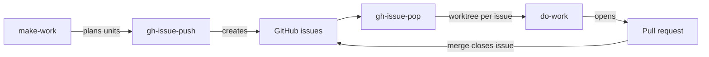
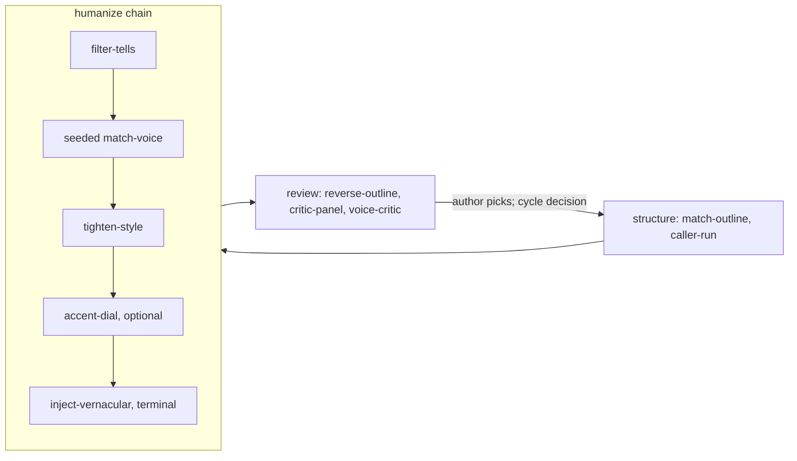

# agent-skills

Claude Code commands and skills for two kinds of work: code delivered through GitHub issues and pull requests, and prose rewritten until it reads as human. Everything is canonical under `.claude/` and mirrored to Cursor, OpenCode, Codex, and GitHub Copilot.

This repository joined [coding-skills](https://github.com/petar-djukic/coding-skills) and [writing-skills](https://github.com/petar-djukic/writing-skills) in November 2026, keeping both histories. coding-skills was renamed to agent-skills, so its old URLs redirect here, and writing-skills is archived. Every consuming project linked both repositories, and writing-skills linked coding-skills' commands into itself; one repository ends that.

## Commands: work through issues

When planning and execution share a context window, coding agents drift: the plan erodes as diffs and test output fill the buffer. The commands separate the two. Planning commands turn intent into GitHub issues that include acceptance criteria; execution commands pop each issue into its own git worktree and close it with a pull request. The issue tracker holds the plan, so no context window has to.



The 14 commands cover the issue workflow (`gh-issue-push`, `gh-issue-pop`, `gh-issue-show`, and `bd-*` equivalents for beads repositories), orchestration (`make-work`, `do-work`), experiments (`exp-start`, `exp-stop`), releases (`gh-release-push`), and repository setup (`bootstrap`, `align-specs`, `test-clone`).

All work passes through issues. `make-work` splits a goal into chunks that fit a single context window; `gh-issue-push` records each chunk as an issue, listing the files to change and the acceptance criteria; `gh-issue-pop` checks out a worktree branch (`../gh-<number>-<slug>`) for the task, then opens the PR. The main branch remains unchanged until a merge. Experiment commands (`/exp-start`, `/exp-stop`) execute locally by default, or, with `--remote <owner/repo>`, operate in a subtree-backed remote-sync mode, preserving a bidirectional `git subtree` link to another repository.

## Skills: prose that reads as human

An AI-generated draft reveals itself in three ways — rhetorical scaffolding, semantic tells, and the drafting model's lexical fingerprint — and fixing one leaves the other two untouched. The pipeline attacks all three in sequence: a structural pass reshapes the prose away from its source, a semantic pass erases the tells, and a cross-model diction pass strips the model's imprint, with a detector score recorded before and after each step. Verified on a published article: 100% AI to mixed, mean window score 0.993 to 0.576.



The 21 skills fall into four kinds (GH-208 in the former writing-skills):

- **The humanize chain.** `humanize` orchestrates one generative pass: `filter-tells` (semantic cleanup), `match-voice` (seeded cross-model diction rewrite, plus the optional burstiness pass), `tighten-style` (word recovery toward the author's density floor), `accent-dial` (optional L2-accent stage), and `inject-vernacular` (the deterministic terminal stage). `match-structure` is the shared library underneath: metrics, anchor retrieval, venue profiles.
- **Structure and review, caller-run.** `match-outline` rewrites a whole document against a blueprint before the chain. After it, `reverse-outline` labels the argument and ranks every paragraph by what deletion costs, `critic-panel` reads a finished draft through persona critics in parallel, `critic-apply` applies that sheet by rule, `cold-review` runs the fresh-context entailment check, `stitch-flow` repairs the joints between paragraphs, and `voice-critic` gatekeeps against the author's voice constitution.
- **The whole thing in one call.** `polish-prose` runs the chain once, then the review instruments in a Workflow loop, until a panel read of the final text changes nothing.
- **Data and corpus tools.** `update-references` and `audit-references` keep a CSL-YAML bibliography current and checked against retrieved sources; `tune-anchors` sweeps anchor queries; `bake-off` compares models so the chain's defaults can be pinned; `patent-disclosure` populates an invention-disclosure template; `pattern-language` extracts Alexandrian pattern languages from repositories.

The target voice sits in a `writing-voice/` directory of exemplar prose; the contract is in [.claude/rules/writing-voice.md](.claude/rules/writing-voice.md). Skills gauge a draft's distance from that corpus, pull anchors from it, and gate every rewrite: a candidate must keep citations, numbers, and meaning, or the original remains. The external Pangram check is consent-gated per document; everything else runs locally against an Ollama endpoint.

## Documentation

- [Three Commands to a Crude Orchestrator](https://meshintelligence.substack.com/p/three-commands-to-a-crude-orchestrator?utm_source=github&utm_campaign=coding-skills): `make-work`, `gh-issue-push`, `do-work`, and the planning/execution split
- [Two Claude Skills and a Worktree Rule](https://meshintelligence.substack.com/p/two-claude-skills-and-a-worktree?utm_source=github&utm_campaign=coding-skills): `gh-issue-pop` and the worktree-per-issue rule
- [How to Code with GLM 5.2 on OpenCode](https://meshintelligence.substack.com/p/how-to-glm-52-on-opencode?utm_source=github&utm_campaign=coding-skills): running the full loop on OpenCode with a cheap model
- [How to Build a Writing Pipeline](https://meshintelligence.substack.com/p/how-to-build-a-writing-pipeline?utm_source=github&utm_campaign=writing-skills): the three passes, and the detector scores before and after each step
- [agentic-coding-book](https://github.com/petar-djukic/agentic-coding-book) and [agentic-applications-book](https://github.com/petar-djukic/agentic-applications-book) draft their chapters through both

## Repository Structure

```
.claude/commands/   the 14 workflow commands
.claude/skills/     the 21 skills, one directory each
.claude/rules/      documentation, git, pixi, README and response rules; the writing-voice contract
.claude/scripts/    shared plumbing: credentials, Pangram client, prose parsing
.cursor/  .opencode/  .agents/  .github/   generated mirrors
scripts/            mirror sync and the test runner
```

## Using it from another repository

A consuming project links `.claude/rules` and `.claude/commands`, one link per skill under `.claude/skills/`, and `.claude/scripts`. Projects set up before the merge link `../coding-skills/...` and `../writing-skills/...`; on a machine with this repository checked out as `agent-skills`, two sibling links keep those paths working:

```bash
ln -s agent-skills coding-skills
ln -s agent-skills writing-skills
```

## Environment

Run the test suite with `scripts/run-tests.sh` (or `mage test`); `mage tag` runs the same gate from a clean `main` and creates the next `v0.YYYYMMDD.N` release tag, counting revisions over local and remote tags.

[pixi](https://pixi.sh/) manages Python dependencies. `pixi.toml` and `pixi.lock` ship in `.claude/`, and `.claude/scripts/ensure-env.sh` provisions the locked environment. Credentials (`pangram`, `serpapi`, `semantic_scholar`, `cohere`) resolve through the nearest `.secrets/` found by walking up from the working directory, typically `~/.secrets`; no credential is ever committed or printed.

## Mirrors

Assistant configuration is canonical under `.claude/` and is generated outward by `scripts/sync-mirrors.sh` (`--check` reports drift, and CI runs it). Cursor and OpenCode receive the commands and skills; Codex reads `AGENTS.md` and finds command skills in `.agents/skills/`. The `.github/` mirror is self-contained: prompts inline the complete workflow and never reference `.claude/`, so `ln -s .../.github .github` drops the configuration into a Copilot repository with no dangling references. See [.claude/README.md](.claude/README.md).

## License

MIT. See [LICENSE](LICENSE).
